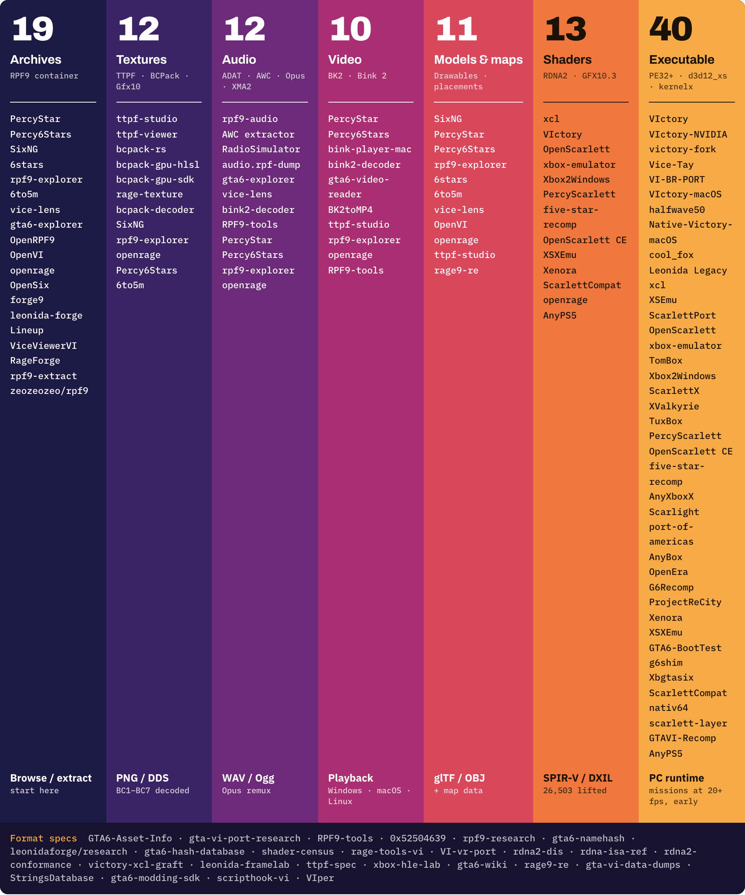

<h1 align="center">
  
</h1>

  A curated index of open-source <b>Grand Theft Auto VI</b> reverse engineering tools for Rockstar's RAGE 9 engine: 
  RPF9 archive explorers, TTPF texture and ADAT/AWC audio decoders, 
  byte-level format specs, and Xbox Series (Scarlett) / PS5 translation layers.

  
  
  
  
  

  <a href="#ecosystem-overview">Map</a> ·
  <a href="#rpf9-archive--asset-explorers">Archive Explorers</a> ·
  <a href="#texture-ttpf--audio-adat--awc-tools">Textures &amp; Audio</a> ·
  <a href="#console-translation-layers--static-recompilation">Recomp &amp; Shims</a> ·
  <a href="#format-documentation--research">Format Docs</a> ·
  <a href="#format--architecture-glossary">Glossary</a> ·
  <a href="#safety--scope">Safety &amp; Scope</a>

> [!WARNING]
> **No playable GTA VI for PC exists.** Any download, installer, or launcher that says otherwise is fake or malware. [Details, and what this list will not link](#safety--scope).

## Ecosystem Overview

Everything starts with an `RPF9` archive. Explorers open it, then each payload type has its own decoders. Most active work targets the Xbox Series X|S (Scarlett) RAGE 9 stack, since Xbox Series runs on x86-64 Zen 2 with RDNA2 (GFX10.3) shaders and a Windows-derived Game OS (`d3d12_xs`, `kernelx`). Early PS5 library-translation efforts exist as well.

  

---

## RPF9 Archive & Asset Explorers

Tools and libraries for inspecting, browsing, salvaging, and exporting `RPF9` containers, 3D drawables (`glTF` / `OBJ`), map placements, and embedded media.

| Project&nbsp;&nbsp;&nbsp;&nbsp;&nbsp;&nbsp;&nbsp;&nbsp;&nbsp;&nbsp;&nbsp;&nbsp;&nbsp;&nbsp;&nbsp;&nbsp;&nbsp;&nbsp;&nbsp;&nbsp;&nbsp;&nbsp;&nbsp;&nbsp;&nbsp;&nbsp;&nbsp;&nbsp;&nbsp;&nbsp;&nbsp;&nbsp;&nbsp;&nbsp;&nbsp;&nbsp;&nbsp;&nbsp;&nbsp;&nbsp; | What it does |
| :--- | :--- |
| **[PercyStar](https://github.com/rpatty-dev/PercyStar)**&nbsp; Rust · Windows, macOS, Linux | Fast RPF9 explorer with Bink 2 video (docked D3D11 on Windows), ADAT Opus audio, a world map tab, a streaming 3D world view, an AWC player, and vehicle configurations. `v1.5.2` adds a typed PSIN XML viewer with hashed-name recovery and a vehicle handling panel. |
| **[Percy6Stars](https://github.com/Ahmet-Dedeler/Percy6Stars)**&nbsp; Rust · macOS, Windows, Linux | Cross-platform PercyStar fork with macOS and Linux support, in-app BK2 video and audio playback (via `bink2-decoder` on Linux), AWC audio previews, 3D model browsing, and a `.ttpf` thumbnail gallery with BCPack BC1 support. |
| **[SixNG](https://github.com/holdmysocks/SixNG)**&nbsp; Rust (`GPL-3.0`) · CLI + GUI, cross-platform | Exports models to `glTF`, textures, and map data, and streams the whole map in a 3D view. Decodes BCPack textures in all six BC formats (some BC7/BC6H blocks can speckle). Since `v0.6` it also exports rigged characters with animation clips, strand hair and fur, cloth, particle effects, and the 4.2 M localised text strings. `v0.7.0` ships Linux and macOS builds. |
| **[6stars](https://github.com/meetox80/6stars)**&nbsp; Swift, Metal · macOS · no license file yet | Native engine that streams the world straight from your own RPF9 archives: full LOD hierarchy, interiors, vegetation, timecycle lighting and weather. Ships an `rpftool` CLI too. |
| **[rpf9-explorer](https://github.com/breadbbbb/rpf9-explorer)**&nbsp; C# · Windows | Archive browser with model, texture, audio, and video previews and asset export. `v1.3` adds assembled vehicle previews and BCPack decoding for BC1, BC3, BC4, and BC5 (BC6H/BC7 not yet). |
| **[6to5m](https://github.com/DesignWithTommy/6to5m)**&nbsp; Rust (`GPL-3.0`) · CLI + MCP server, cross-platform | The only GTA VI → GTA V / FiveM converter so far. Turns map areas into FiveM resources with BCPack textures, collision, LOD placements, MLO interiors with decoded portals, navmesh, vehicles, weapons, and peds. |
| **[vice-lens](https://github.com/Librett0/vice-lens)**&nbsp; Rust (`MIT`) · Windows, Linux | Desktop explorer with a map of placements, 3D models, vehicles, animated characters, textures, Bink movies, audio and text, and glTF / PNG / Opus / MP4 export. Finds files by scanning for zlib streams, so it needs no table of contents. BCPack-only mips are not decoded yet. |
| **[gta6-explorer](https://github.com/HolyRoses/gta6-explorer)**&nbsp; Python (`MIT`) · CLI, cross-platform | Read-only, dependency-free toolkit covering RPF9, TTPF textures to DDS/PNG, Bink and AWC carving, PSIN schemas, shader recovery and name-hash dictionaries, with a 189-check self-test. BCPack is partial (BC1 from `bcpack-rs`, provisional BC3/4/5); models go through a SixNG binary you supply. |
| **[OpenRPF9](https://github.com/shrewbrewsh/OpenRPF9)**&nbsp; C# (`MIT`) · Windows | Small WinForms inspector that carves compressed streams straight out of an archive (no table of contents needed) and shows them as hex, text or XML. Also opens standalone `.ttpf` files with plain BC1-BC7 decoding and PNG export, and remuxes AWC Opus. No BCPack. |
| **[Lineup](https://github.com/TheAirborneCoder/Lineup)**&nbsp; Python, JS (`GPL-3.0`) · local web viewer | Character viewer for build `1.0.2.1`: indexes peds, clothing and animation clips from your own archives by scanning streams (no decryption) and shows textured models with skeletons in the browser, served on loopback only. Strand hair is approximate and most export paths are untested; its counts are self-reported from one PC. |
| **[rpf9-extract](https://github.com/offs/rpf9-extract)**&nbsp; Rust · CLI, cross-platform | Clean-room CLI extractor and inspector (`-n` list, `-v` header fields and PSIN tables). |
| **[zeozeozeo/rpf9](https://github.com/zeozeozeo/rpf9)**&nbsp; Rust · library crate | Minimal clean-room Rust library implementing the `RPF9` archive format with runnable `examples/`. |

---

## Texture (`.ttpf`) & Audio (`ADAT` / AWC) Tools

Focused decoders for RAGE 9 GPU-tiled texture packs (`.ttpf`, `BCPack`, `Gfx10` swizzling), audio containers (`ADAT` / `AWC` Opus and `XMA2` banks), and Bink 2 (`.bk2`) media.

| Project&nbsp;&nbsp;&nbsp;&nbsp;&nbsp;&nbsp;&nbsp;&nbsp;&nbsp;&nbsp;&nbsp;&nbsp;&nbsp;&nbsp;&nbsp;&nbsp;&nbsp;&nbsp;&nbsp;&nbsp;&nbsp;&nbsp;&nbsp;&nbsp;&nbsp;&nbsp;&nbsp;&nbsp;&nbsp;&nbsp;&nbsp;&nbsp;&nbsp;&nbsp;&nbsp;&nbsp;&nbsp;&nbsp;&nbsp;&nbsp;&nbsp;&nbsp;&nbsp;&nbsp;&nbsp;&nbsp;&nbsp;&nbsp;&nbsp;&nbsp;&nbsp;&nbsp;&nbsp;&nbsp; | What it does |
| :--- | :--- |
| **[ttpf-studio](https://github.com/woreksami/ttpf-studio)**&nbsp; Python · GUI, cross-platform | View, export, and replace `.ttpf` textures (BC1-BC7, GPU unswizzling, headerless scan recovery). Also recovers RPF9 files, exports models to OBJ, and plays Bink video. `v1.1` adds a GPU 3D view that assembles whole vehicles with their own paint, rims and tyres. |
| **[ttpf-viewer](https://github.com/paryzius/ttpf-viewer)**&nbsp; Rust (`MIT`) · Windows; macOS / Linux from source | Fast `.ttpf` gallery and extractor with exact Gfx10 tile/mip layouts, 3D cube maps, and PNG or lossless DDS export. Documents the `RDS5`/`ETPF` header. BCPack-only mips are not decodable yet. |
| **[bcpack-rs](https://github.com/Ahmet-Dedeler/bcpack-rs)**&nbsp; Rust, Python (`MIT OR Apache-2.0`) · CLI, cross-platform | Standalone clean-room decoder for `BCPack`, the Xbox Series texture compression. **BC1 decodes** and is checked on held-out data. The entropy layer also converges exactly for BC3 through BC7; their block decoders are in progress. |
| **[rage-texture](https://github.com/ifBars/rage-texture)**&nbsp; Rust, Python (`GPL-3.0-only`) · library + CLI, Windows/Linux | Texture library built on `bcpack-rs` for the entropy layer, with block decoders adapted from SixNG and Leonida (credited). Indexed `.ttpf` reads, DDS with full mip chains, PNG previews, batch export, and Python bindings. Lossless by default; fitted BCPack output is opt-in and labelled provisional. Tested against one build. |
| **[bcpack-decoder](https://github.com/Tim0219800/bcpack-decoder)**&nbsp; Rust (`MIT`) · CLI, cross-platform | A second, independent clean-room BCPack decoder with zero dependencies. Ships no fitted tables: `learn-tables` derives the BC1 tables from your own data, after which BC1 decodes. Decodes the entropy lanes for BC3 through BC7 without rebuilding blocks. Spec in English and French. |
| **[rpf9-audio](https://github.com/jaylikesbunda/rpf9-audio)**&nbsp; Python · CLI, cross-platform | Dependency-free, read-only RPF9 and `ADAT`/AWC audio toolkit. Extracts Opus packets, decodes to WAV, and remuxes playable Ogg Opus. |
| **[AWC_from_RPF9_Extractor](https://github.com/Albotterin/AWC_from_RPF9_Extractor)**&nbsp; Python (`MIT`) · Windows GUI; source runs anywhere with tkinter | Music extractor: scans `.rpf` / `.awc` files for `ADAT` streams and remuxes the Opus packets unchanged into Ogg Opus, with a built-in player. Names streams by song, artist and radio station (matched against Rockstar's public credits list, which it downloads once) and has a station-by-station radio player. `v2.1.0` fixes the archive scan to find 2,968 music containers instead of 2,684 and adds three stations. Skips SFX, speech, and XMA banks. |
| **[SixFM](https://github.com/jaylikesbunda/SixFM)**&nbsp; Rust, Tauri · Windows · no license file yet | Radio tool from the author of `rpf9-audio`: simulates the station scheduler, extracts premixed stations packet for packet, and turns a folder of MP3s into an Opus mix plus a game-format AWC. Can patch a premixed station inside your own `audio.rpf` in place, after writing a backup. Tied to build `1.0.2.1`; downloads ffmpeg on request with a pinned hash. The in-game result is the author's claim. |
| **[bink2-decoder](https://github.com/codingkoala/bink2-decoder)**&nbsp; Rust (`Apache-2.0`) · library + CLI, cross-platform | Clean-room Bink 2 (`.bk2`) video and Bink Audio (DCT) decoder with `bk2dump` and `bk2wav` examples. Powers Linux BK2 playback in `Percy6Stars`. |
| **[gta6-video-reader](https://github.com/hoshino-114514/gta6-video-reader)**&nbsp; Python, C (`MIT`) · Windows x64 | Bink 2 to MP4 pipeline that hosts the game's own Bink DLL (you supply it and compile the small C host yourself). Its notes from a 520-file sweep document decoder quirks: padded buffers, a chroma slot swap, a last-frame stall, multi-track audio. |
| **[BK2toMP4](https://github.com/FluffyCyanNova/BK2toMP4)**&nbsp; Python (`MIT`) · Windows | Batch `.bk2` to `.mp4` converter that drives your installed RAD Video Tools, plus an RPF9 Bink carver ported from `rpf9-explorer` (credited). |

---

## Console Translation Layers & Static Recompilation

Projects translating Xbox Series X|S (`Scarlett`) or PS5 system libraries, memory models, and RDNA2 shaders so console binaries can run natively on PC. The game's executable leaked on 2026-11-23 and several of these projects now start it. The furthest public results are `VIctory` and `xcl`, which both reach the game's menus; `VIctory` also loads into the world, where rendering is still mostly dark at about a second per frame. **Nothing is playable.**

| Project&nbsp;&nbsp;&nbsp;&nbsp;&nbsp;&nbsp;&nbsp;&nbsp;&nbsp;&nbsp;&nbsp;&nbsp;&nbsp;&nbsp;&nbsp;&nbsp;&nbsp;&nbsp;&nbsp;&nbsp;&nbsp;&nbsp;&nbsp;&nbsp;&nbsp;&nbsp;&nbsp;&nbsp;&nbsp;&nbsp;&nbsp;&nbsp;&nbsp;&nbsp;&nbsp;&nbsp;&nbsp;&nbsp;&nbsp;&nbsp; | What it does and where it stands |
| :--- | :--- |
| **Leonida**&nbsp; `ItsNotRexed/Leonida` · offline since 2026-11-23 | **No longer public.** Was the scene's largest effort, a static recompilation project for build `1.0.2.1` with thousands of merged PRs. Its author announced he was stepping away on 2026-11-23 and the repository and its Discord went offline the same night. Before that it translated all 26,503 RDNA2 shaders to SPIR-V, exported models, textures and audio, and took the leaked executable through memory setup and device creation with no frame. Many copies exist. The most active continuation with full history is [ubiquitarianism/leonida](https://github.com/ubiquitarianism/leonida) (checked for game files only, not reviewed). |
| **[Xbox2Windows](https://github.com/R0Y00/Xbox2Windows)**&nbsp; C++, Python (`MIT`) · Xbox Series → Windows | Static recompilation research: translates selected x64 code to C++ and gfx1013 shaders to desktop DXIL. Source-built programs run from entry to exit. It merged a one-command converter for the leaked executable, but running the game's own CPU code is still unverified (tracking issue #870). |
| **[xcl](https://github.com/ivall/xcl)**&nbsp; Rust (`GPL-2.0`) · Xbox Series X\|S → Windows (D3D12) | Wine-style compatibility layer: game x64 code runs natively while XCL reimplements `kernelx`, `d3d12_xs`, DirectStorage, and XAudio2. All 26,698 programs in a RAGE 9 `shaders.rpf` translate. **Minecraft Preview and *Unicorn Overlord* are fully playable.** **GTA VI:** the maintainer reports it starting in about 4 s, holding 30 fps without a crash and showing its menus through to settings; gameplay is not reached and it needs about 15 GB of memory. Run it with `XCL_NETWORK=0`, because the game's crash reporter uploads a minidump on every crash. |
| **[VIctory](https://github.com/Marvisak/VIctory)**&nbsp; Rust (`GPL-3.0-or-later`) · Xbox Series X\|S → Windows (D3D12) | GTA VI-specific runtime: loads the game's x86-64 code natively, reimplements the console APIs, and recompiles RDNA2 shaders to DXIL on first use. **The furthest public GTA VI result:** boot, first-boot screens, intro video with sound and the start screen run at 30 fps, and it loads into the world, where most of the scene is still dark at 0.5 to 1.8 s per frame. Tested on one machine (self-reported); entering the world can hang the GPU driver. Blocks the game's network access by design. Ships the BCPack format's constant tables (78 KB). |
| **[xbox-emulator](https://github.com/omonkeyz/xbox-emulator)**&nbsp; Rust (`GPL-3.0-or-later`) · Xbox Series X\|S → Windows | Active continuation of `TomBox`. Reimplements `d3d12_xs`, RDNA2 shader translation, and console OS DLLs, with automated per-function progress maps. *Trackmania* boots and plays; Fortnite reaches its lobby but is not playable. GTA VI: a contributor's Wine notes (issue #293) reach the game window, device and archives with local patches, then stop before any pipeline is created. |
| **[TomBox](https://github.com/drycheetah84/TomBox)**&nbsp; Rust · Xbox Series X\|S → Windows | Upstream compatibility runtime that `xbox-emulator` builds upon. One title reaches its main menu; not playable. |
| **americas-recomp**&nbsp; `realdody/americas-recomp` · offline since 2026-11-23 | **No longer public.** Tested whether AnyPS5's shader recompiler can run Xbox Series shaders: at least 99.6% of each shader stage produced valid SPIR-V. The repository disappeared on 2026-11-23, shortly before Leonida. |
| **[OpenScarlett](https://github.com/californiaAlmonds/OpenScarlett)**&nbsp; C++20 (`MIT`) · Xbox Series X\|S → Windows | Clean-room Scarlett translation layer: PE32+ loader, `d3d12_xs` proxy, `kernelx` memory aliasing, RDNA2 → SPIR-V/DXIL lifter, and GDeflate/BCPack/XMA2/Bink2 codecs. `v0.6.0-alpha` runs six unmodified Microsoft Scarlett samples, and `main` now reports retail *Minecraft Preview* playable at about 60 FPS (self-reported, on one GPU). A 2026-11-23 commit reports the GTA VI executable resolving all 587 imports and getting through device and 4K render-target setup (self-reported, no frame). |
| **[ScarlettX](https://github.com/Freminet/ScarlettX)**&nbsp; C++ · Xbox Series X\|S → Windows · no license file yet | Clean-room high-level emulator for GDK titles. *Concept Destruction* and *Unicorn Overlord* are playable on a hardware GPU. |
| **[XValkyrie](https://github.com/sammwyy/xvalkyrie)**&nbsp; C++20 (`GPL-3.0`) · Xbox One + Series X\|S → Windows | Wine-style translation layer for both console generations. *Terraria* is playable on Xbox One, and *Unicorn Overlord* and *Minecraft Preview* are playable on Xbox Series X\|S. Its compatibility table covers 49 titles: 8 playable, 12 reach a menu. |
| **[TuxBox](https://github.com/brcly/TuxBox)**&nbsp; Rust, Python · Xbox Series X\|S → Linux (Proton) · no license file yet | Native-first layer for unpacked, decrypted Series games under stock Proton Experimental. *The Matrix Awakens* runs from its menu into the open city with reduced graphics settings (some surfaces still missing; at original Xbox settings it stops on a compute shader). GTA VI shows its player selection prompt at 3840×2160 (self-reported). |
| **[PercyScarlett](https://github.com/rpatty-dev/PercyScarlett)**&nbsp; Rust (custom non-commercial license) · Xbox Series X\|S → Windows (D3D12) | Translation layer from PercyStar's author with nine shim DLLs and a self-test GUI. Boots 6 / 6 unmodified Scarlett GDKX samples, and since `v0.9.0` retail *Minecraft* (Series build) reaches its menu and plays in-world, with heap corruption on about half of launches (self-reported). GTA VI reaches a frame loop presenting black frames, then stops on a GPU hang about 5 s in. Its strict shader lifter converts 3,060 / 21,522 programs to HLSL with zero placeholder fallback. |
| **[OpenScarlett (OpenCommunityEdition)](https://github.com/OpenCommunityEdition/OpenScarlett)**&nbsp; C++ (`AGPL-3.0`) · Xbox Series X\|S → Windows, Linux (Wine) | Unrelated to the OpenScarlett above despite the name. Replacement system DLLs on PC D3D12 with an RDNA2 → HLSL translator; also runs under Wine with patched vkd3d-proton. Reports *Minecraft Preview* playable and *The Matrix Awakens* partly running (self-reported, with video). No audio. |
| **[five-star-recomp](https://github.com/ThatRecompDev/five-star-recomp)**&nbsp; C# / .NET 10 (`GPL-3.0`) · Xbox Series → Windows | GTA VI-specific toolchain: its own RDNA2 disassembler and HLSL translator, archive / texture / model readers, a pipeline-cache reader, and a module loader with offline GDK shims. Its own renderer draws one test frame with a translated game shader. The leaked executable starts under its loader and gets through memory setup, archive opening and graphics device setup, then stops before its first frame. |
| **[AnyXboxX](https://github.com/LooperSalty/AnyXboxX)**&nbsp; Python, C++, Rust (`GPL-3.0`) · Xbox Series → Windows | Loads GDK executables two ways: isolated under Unicorn with Python HLE, or natively with a C++ GDK runtime (about 210 functions). Includes an RDNA2 disassembler and reference interpreter. Reuses Leonida, TomBox and Xbox2Windows parts (credited). Has run two free test programs only. |
| **[AnyBox](https://github.com/Dark3581/AnyBox)**&nbsp; C++20 (`GPL-2.0`) · Xbox Series → Windows | A different approach: statically relinks a decrypted GDK executable's import table to its own libraries, then lets the normal Windows loader run it. Unimplemented calls stop with a run report. Most of D3D12.X is still stubbed and no title has run. |
| **[G6Recomp](https://github.com/Kajcsi/G6Recomp)**&nbsp; C++ (`GPL-3.0`) · Xbox Series → Windows | Native loader with a hook engine plus an x86-64 static recompiler (function discovery from `.pdata`, jump tables), tested on the dump's side DLLs. No graphics layer or shader translation yet; nothing boots. |
| **[rebox](https://github.com/puffnfresh/rebox)**&nbsp; C, C++ (`GPL-2.0`) · Xbox Series → Linux (Wine) | Runs Series GDK titles on Linux through WineGDK, vkd3d-proton and console DLL shims, compiling RDNA2 shaders to SPIR-V with AnyPS5 at draw time instead of going through HLSL. Not GTA-specific. Reports one GDK title reaching gameplay (self-reported); rendering is incomplete and audio is silent. |
| **[GTA6-BootTest](https://github.com/OnlyMoisties/GTA6-BootTest)**&nbsp; C · Windows · no license file yet | Stand-in console DLLs, a debugger harness and an RDNA2 shader translator for the leaked executable. Reports the game booting, streaming its archives, running its frame loop and drawing its first UI screen (the start-screen prompt bar) through translated shaders; compute, tiled textures and blending are unfinished (self-reported). `REPORT.md` documents the D3D12.X vtable slots, `xmem` semantics and `xgameruntime` interfaces it found. |
| **[scarlett-layer](https://github.com/jadeowaowa/scarlett-layer)**&nbsp; C++ (`Apache-2.0`) · Xbox Series X\|S → Windows | Loader + hook DLL that routes imports of unpacked, unencrypted GDK executables to its shims. 78 automated checks. Unpacked *Terraria* (Xbox GDK) boots and renders its menus with audio; input and gameplay are not there yet. Rejects encrypted packages by design. |
| **[GTAVI-Recomp](https://github.com/JamesCicada/GTAVI-Recomp)**&nbsp; C++ · PS5 → PC | GTA VI layer on top of AnyPS5. Refuses to work from game files, keys, or leaked material, so nothing has been tested with GTA VI. |
| **[AnyPS5](https://github.com/boykopovar/AnyPS5)**&nbsp; C++ (`GPL-2.0`) · PS5 → Windows / Linux | General PS5 system-library reimplementation (no emulation) with an RDNA2 → SPIR-V shader recompiler. Not GTA-specific, but it is the upstream that `GTAVI-Recomp` and `rebox` build on. |

---

## Format Documentation & Research

Byte-level specifications, field confidence tables, and reproducible inspection scripts reverse engineered from local file headers and decoded outputs.

| Project&nbsp;&nbsp;&nbsp;&nbsp;&nbsp;&nbsp;&nbsp;&nbsp;&nbsp;&nbsp;&nbsp;&nbsp;&nbsp;&nbsp;&nbsp;&nbsp;&nbsp;&nbsp;&nbsp;&nbsp;&nbsp;&nbsp;&nbsp;&nbsp;&nbsp;&nbsp;&nbsp;&nbsp;&nbsp;&nbsp;&nbsp;&nbsp;&nbsp;&nbsp;&nbsp;&nbsp;&nbsp;&nbsp;&nbsp;&nbsp; | What it covers |
| :--- | :--- |
| **[GTA6-Asset-Info](https://github.com/TrinitronClient/GTA6-Asset-Info)**&nbsp; 19-part asset format spec | Maintained by the SixNG team. Covers `RPF9`, texture dictionaries, `ttpf`, `BCPack` codec types, models, map data, materials, collision, navmesh, PSO schema, and `AWC`/`ADAT` audio. |
| **[gta-vi-port-research](https://github.com/oguzhanozfe/gta-vi-port-research)**&nbsp; Xbox-to-PC research handbook | Markdown format documentation and reproducible Python file-inspection scripts in `tools/`. |
| **[0x52504639](https://github.com/SentinelInteractive/0x52504639)**&nbsp; 12-document RPF9 / TTPF research set (`MIT`) | Maps the 64-byte `RPF9` header, both record tables and the trailer, texture addressing, and the BCPack entropy layer. Also records what is known about the still-unbroken table cipher; it publishes no key. |
| **[rpf9-research](https://github.com/JoshRob297/rpf9-research)**&nbsp; RPF9 notes + Python tools (`GPL-3.0`) · English and Spanish | Evidence-backed notes on the RPF9 header, table-of-contents layout and nested containers, with a source-level comparison of three public parsers. Its tools recover asset names from payloads without the encrypted table. Decrypts nothing. |
| **[gta6-namehash](https://github.com/tarekmania/gta6-namehash)**&nbsp; Python (`MIT`) · CLI + JSON | Shared joaat hash → name dictionary for the unknown field and struct hashes in RAGE 9 data. Built only from public GTA V name lists, hashed both case-sensitively and lower-case: about 498k hashes. Marks each result confirmed (already named by a GTA VI project) or candidate (a hash match only). Names 85 of the 375 hashes in the published format notes. |
| **[rage-tools-vi](https://github.com/lynxnathan/rage-tools-vi)**&nbsp; Python, Rust (`MIT`) | Rebuilds RPF9 entries from payload scans instead of the encrypted TOC, checked by zlib checksum. Also decodes ADAT/AWC audio and PSIN/LSNS schemas, and ships a 37k hash → name registry plus large offset and hash manifests. No original file paths are recovered. |
| **[gta6-vr-port](https://github.com/dariulone/gta6-vr-port)**&nbsp; Python, Rust · no license file yet | Static analysis notes on the executable aimed at a future OpenXR stereo port: where renderer init, presentation, camera, culling and skinning live, with a read-only IDAPython harness. Notes and offsets only; no VR code runs. |
| **[RPF9-tools](https://github.com/frenzy42069/RPF9-tools)**&nbsp; Byte-level `format_desc.md` + C/Python scripts | `RPF9` container geometry, PSIN checks, Bink2 range carving, and `ADAT` Opus extraction. Ignore the satirical disclaimer in the README. |
| **[rage9-re](https://github.com/Ahmet-Dedeler/rage9-re)**&nbsp; Rust + Python · script and animation data | Decodes `script.rpf` PSO script data and `anim.rpf` crAnimation channels, with glTF 2.0 export and byte-level notes in `docs/`. Tests use synthetic data only. |

---

## Visualizers & Related Experiments

Standalone graphics and media tools built alongside GTA VI / RPF9 format exploration.

- [Ahmet-Dedeler/weather-study](https://github.com/Ahmet-Dedeler/weather-study) (`TypeScript / WebGL2`) - Open-source WebGL2 weather engine and timecycle visualizer with volumetric clouds, ocean reflections, branching lightning, and 4K capture, inspired by RPF9 research.
- [Ahmet-Dedeler/bink-player-mac](https://github.com/Ahmet-Dedeler/bink-player-mac) (`Objective-C / macOS`) - Native macOS Bink2 (`.bk2`) video player, plus `tools/bk2mp4.sh` to convert `.bk2` to mp4 with video and all audio tracks using librempeg's open-source Bink 2 decoder (matched to RAD's output in [librempeg#217](https://github.com/librempeg/librempeg/pull/217) and [librempeg#218](https://github.com/librempeg/librempeg/pull/218), merged upstream), no RAD code.

**See also:** [PortWatch VI](https://github.com/4lwayz/portwatch-vi), a daily tracker of the PC port efforts that also flags clone networks and re-uploads of tracked projects, and [Does Leonida Boot?](https://doesleonidaboot.com/race), an automated 3-minute live telemetry tracker covering the Leonida boot chain alongside VIctory, XCL, Five Star Recomp, Xbox2Windows, and TuxBox (with public JSON, RSS, and `/llms.txt` feeds).

---

## Format & Architecture Glossary

Quick reference for terms that show up across these repositories:

| Term | Meaning |
| :--- | :--- |
| `RPF9` | Rockstar Package File v9 (`9FPR` / `0x52504639`). Next-generation archive container used by GTA VI / RAGE 9, supporting nested RPFs, PSIN tables, and zlib/BCPack payloads. |
| `TTPF` | RAGE 9 texture store format holding mipmapped GPU-swizzled surfaces (`BC1`-`BC7`, `RGBA8`, `RGBA16F`, texture arrays, cubemaps). |
| `BCPack` | Block-compression stream format used on Xbox Series X\|S alongside GDeflate to compress GPU textures and resource pages. |
| `ADAT` / `AWC` | Rockstar audio bank containers storing multi-stream `Opus` and `XMA2` voice, SFX, and radio assets. |
| `BK2` (Bink 2) | RAD Game Tools video codec used in `movies.rpf` reels and UI cutscenes. |
| `RDNA2` (`GFX10.3`) | AMD GPU ISA used by Xbox Series X\|S and PS5. Tools like `xcl`, `VIctory` and `OpenScarlett` lift precompiled RDNA2 shader binaries to `SPIR-V` (Vulkan) or `DXIL` (D3D12). |
| `Scarlett` / `d3d12_xs` | Microsoft codename for Xbox Series X\|S and its console-extended Direct3D 12 + `kernelx` runtime shimmed on Windows by `OpenScarlett`, `xbox-emulator`, and `xcl`. |

---

## Safety & Scope

> [!IMPORTANT]
> **Clean-room research and open-source code only.** This list indexes reverse engineering tools, clean-room reimplementations, and format documentation. It does **not** host, link to, or endorse game executables, copyrighted assets, encryption keys, DRM bypass tools, or leaked build downloads. Every tool listed expects you to supply files from your own copy on disk.

> [!CAUTION]
> **There is no playable GTA VI for PC.** The game executable (`game_scarlett_master.exe`) leaked on 2026-11-23. A few open-source runtimes now start it and two reach its menus, but none reaches gameplay. This list does not link the executable. If you run it yourself, block its network access first: its crash reporter uploads a memory dump from your IP on every crash. Any "GTA 6 PC download", "Switch/PS5 emulator", installer, or prebuilt launcher `.exe` is fake at best and malware at worst. One public "launcher" template even ships a self-signed `CN=Rockstar Games, Inc.` certificate with its private key, so anything signed with it shows Rockstar's name in the file's signature details (Windows still marks it untrusted). Fake "leaked executable" and launcher downloads are circulating, and a scam kit built around a fake installer is reportedly being sold. Build tools from source you have read. For how one of these fakes works, [Cyberleek-Gta6-Malware](https://github.com/Justyyin/Cyberleek-Gta6-Malware) is a write-up of the October 2026 fake "Cyberleek Launcher" with defanged indicators, the defanged script text and untested detection rules (no working sample hosted).

### Inclusion Criteria & Exclusions

To keep this directory useful and safe, projects are audited before being added:

- **Included:** Real working code, libraries, format specs, or active runtime/translation research backed by actual commits.
- **Excluded:** Empty placeholder repos (0 commits / empty tree), raw extracted copyrighted game strings or assets (including text dumps of the build), decryption keys or key material (research that documents the archive cipher without publishing a key is fine), cheat-code / wallpaper hubs, `make.fun` bounty/meme repos, and clickbait "100% playable GTA 6 PC port" or malware-bait repositories.
- **Also excluded:** the dozens of identical `GTA-6-Switch-Version--PC-Emulator-2026` / "PC installer hub" repos, fake or Rockstar-branded launchers (including ones signed with a fake `Rockstar Games, Inc.` certificate), README-only "recomp" repos with a release attached, repos whose only download is an unverified prebuilt `.exe`, and renamed forks of projects already listed (the original is linked instead).

---

## Contributing

Know an open-source RAGE 9 / RPF9 / GTA VI reverse engineering tool, library, or format writeup that belongs here?

1. Check [CONTRIBUTING.md](CONTRIBUTING.md) to verify clean-room compliance and format guidelines.
2. Open a pull request or [submit a project via the issue form](https://github.com/Ahmet-Dedeler/awesome-gta6-reverse-engineering/issues/new?template=submit-project.yml).

Questions, or want to talk formats? [Join the Discord](https://discord.gg/CjcDBg3nf).

## License

To the extent possible under law, contributors have waived all copyright and related or neighboring rights to this curated list under [CC0 1.0 Universal](LICENSE). Linked projects remain under their respective licenses.
